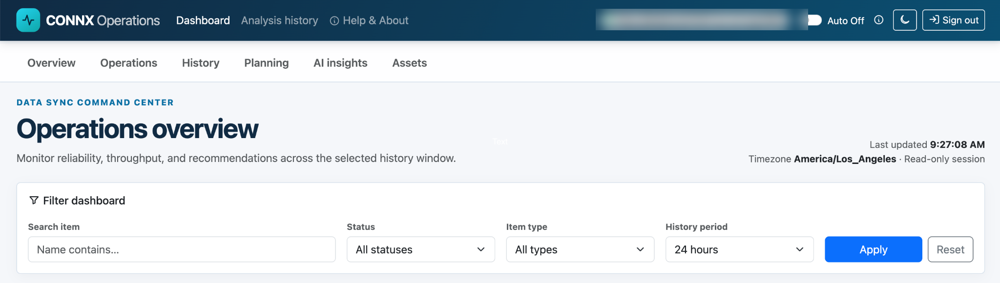
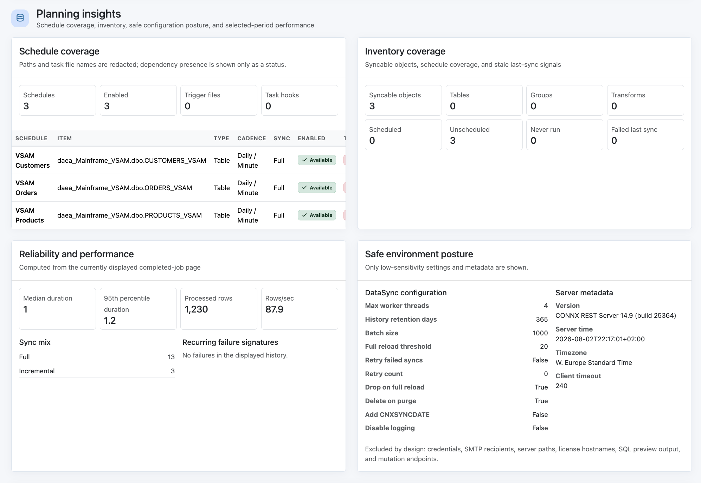
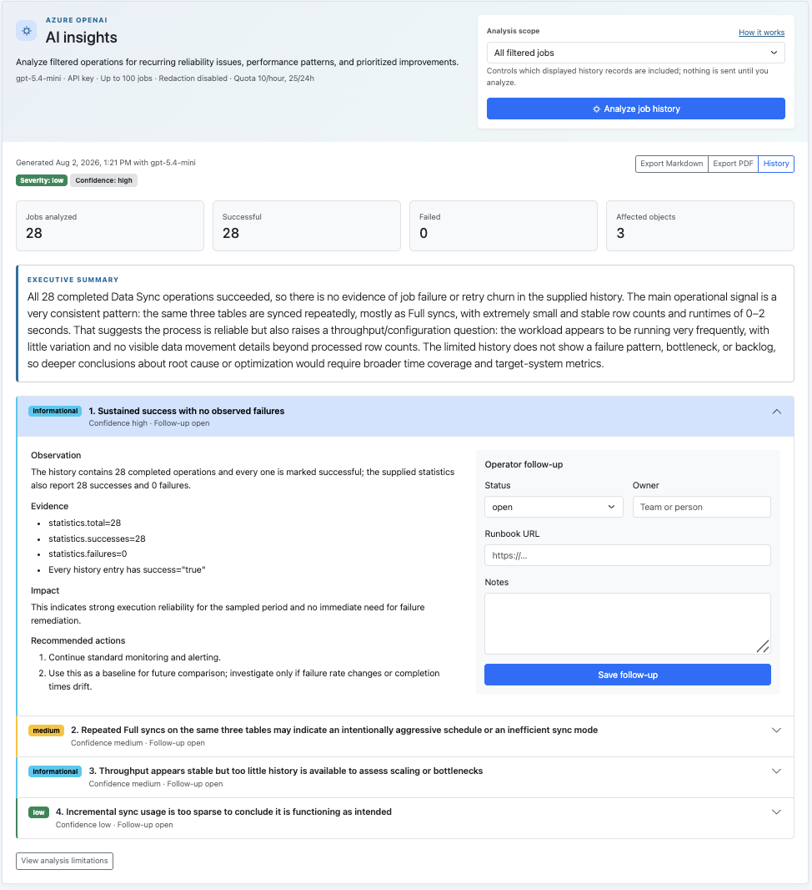
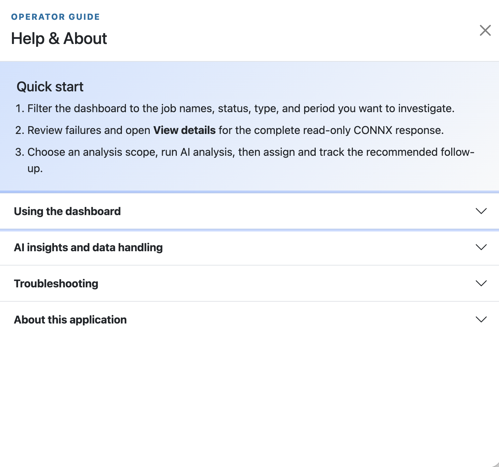

# CONNX Data Sync Operations Dashboard

[Apache License 2.0](LICENSE) · [Contributing](CONTRIBUTING.md) ·
[Security policy](SECURITY.md) · [Security review](SECURITY_REVIEW.md)

Software AG CONNX DataSync is the data replication and synchronization component of the CONNX data integration platform. It is designed to keep data synchronized between legacy systems, relational databases, data warehouses, and cloud platforms with near real-time or scheduled updates.

The CONNX REST API is documented with OpenAPI and published through Swagger UI.
Depending on the CONNX REST Server release, the UI is commonly available at
`https://<connx-rest-server>:<port>/swagger` or
`https://<connx-rest-server>:<port>/swagger/ui/index`, where `port` is the
listening port (9500 is the default). The UI links to the OpenAPI JSON/YAML
document used to describe the available operations.

This application is a reference for how to use the CONNX REST APIs for a standalone Flask dashboard for monitoring CONNX Data Sync operations and
requesting operator-reviewed Azure OpenAI recommendations from filtered job
history.

The dashboard is read-only with respect to CONNX Data Sync: it reads status and
object endpoints and never starts, edits, or cancels a sync. It does maintain
local application data: operators can create, update, export, and delete saved
AI analyses and finding acknowledgement, ownership, status, and notes in the
configured SQLite database.

## Feature tour

The dashboard is organized around an operator's read-only monitoring workflow:

1. **Overview and live activity** — review server/DataSync readiness, completed
   and running jobs, throughput, failures, and current refresh state.
2. **History and filters** — search and paginate completed jobs, inspect table,
   group, and transform status, and preserve filter state while navigating.
3. **Planning and reliability** — review schedule coverage, syncable inventory,
   duration percentiles, processed rows, rows/sec, sync mix, and recurring failure
   signatures when the CONNX role can access those optional endpoints.
4. **AI analysis** — submit a bounded, redacted history window for an
   operator-reviewed Azure OpenAI analysis, retain the result locally, export it,
   and track finding ownership, status, acknowledgement, and notes.
5. **Help & About** — see safe application and server metadata, configuration
   boundaries, retention/redaction behavior, and links to support documentation.



*Dashboard overview from the synthetic demo installation.*



*Planning and reliability panels from the synthetic demo installation.*



*AI analysis workflow from the synthetic demo installation.*



*AI analysis and Help & About workflow from the synthetic demo installation.*

## Dashboard feature and API matrix

The dashboard uses read-oriented CONNX endpoints for operational data, plus the
authentication and session endpoints needed to sign in, refresh, and log out.
It never calls CONNX synchronization, cancellation, SQL-preview, or
configuration-write operations. Some planning panels are optional and degrade
to an unavailable/permission message when the signed-in CONNX role cannot access
them.

| Dashboard area | CONNX endpoint(s) | Access and behavior |
| --- | --- | --- |
| Server and DataSync readiness | `/api/ds/env`, `/api/svr/env` | Read-only; DataSync readiness and safe server metadata are shown independently so a partial outage remains visible. |
| Completed and running jobs | `/api/status/completedjobs`, `/api/status/runningjobs` | Read-only; supports filtering, pagination, throughput, and ETA context. |
| Object status | `/api/object/tableswithstatus`, `/api/object/groupswithstatus`, `/api/object/transformswithstatus` | Read-only; individual object panels tolerate empty or unavailable responses. |
| Schedule coverage | `/api/object/schedules` | Optional read-only planning panel; dependency paths and mutation controls are intentionally excluded. |
| Syncable inventory | `/api/object/allobjects` | Optional read-only inventory and stale/failed-last-sync context. |
| Configuration and server posture | `/api/config/settings`, `/api/svr/env` | Optional; only an allowlisted, non-secret subset is rendered. |
| AI analysis and findings | Local Flask routes plus Azure OpenAI | CONNX is not mutated; filtered history is redacted/configured before the model request and results remain in local SQLite. |

## CONNX REST API reference implementation

This project is also a small, defensive reference for consuming selected CONNX
Swagger endpoints from a server-side application. The live Swagger document on
your CONNX installation is authoritative for deployment-specific versions,
field casing, permissions, and additional endpoints:
`https://<connx-rest-server>:<port>/swagger`.

### OpenAPI and Swagger in plain language

**OpenAPI** is a machine-readable description of an HTTP API. It records paths,
HTTP methods, query parameters, request bodies, response schemas, authentication
requirements, and possible status codes. **Swagger** is the family of tools and
the interactive web interface commonly used to publish and explore an OpenAPI
document. In practice, use the Swagger UI to discover an endpoint and its
**Try it out** request, then use the OpenAPI JSON/YAML document as the precise
contract for automation.

The exact UI path varies by CONNX REST Server release; common installations use
`/swagger` or `/swagger/ui/index`, with a JSON document linked from the UI. Set
the server's **Authorize** bearer value only in a private development session.
Do not paste production credentials or tokens into a screenshot, browser-share
session, ticket, or committed example. The dashboard's code intentionally keeps
CONNX API access on the server side so bearer tokens never reach browser code.

When evaluating an endpoint in Swagger UI:

1. Confirm the HTTP method and required authentication scheme.
2. Start with a narrow, read-only request and a small page size.
3. Record the actual response wrapper and field casing from the target CONNX
   release; do not assume that a field shown in one release exists in another.
4. Check `401`, `403`, `404`, `429`, and `5xx` behavior before integrating it.
5. Add a bounded parser, an allowlist, an unavailable state, and fixture tests.

The reference implementation follows that workflow in
[`connx_rest_app.py`](connx_rest_app.py): `call()` centralizes authentication,
timeouts, TLS verification, and one-time token refresh; `get_json()` validates
JSON-object responses; and the `datasync_environment()`,
`schedule_insights()`, `inventory_insights()`, `config_posture()`, and
`server_metadata()` helpers convert version-dependent responses into safe view
models. The tests in [`tests/test_connx_rest_app.py`](tests/test_connx_rest_app.py)
use local fixtures to exercise success, partial outage, and permission-denied
responses without contacting a live CONNX server.

### 1. Authenticate and manage the bearer session

The dashboard posts credentials to `POST /api/svr/security/login`:

```http
POST /api/svr/security/login
Accept: application/json
Content-Type: application/json

{"username":"<CONNX_USER>","password":"<CONNX_PASSWORD>"}
```

Successful deployments return an access token, commonly as `accessToken`, and
may return a `refreshToken`. Subsequent requests send the access token as:

```http
Authorization: Bearer <ACCESS_TOKEN>
Accept: application/json
```

When a request returns `401`, the implementation attempts one
`POST /api/svr/security/refreshtoken` call with the refresh token, stores the
replacement token pair server-side, and retries the original request once. It
does not loop on repeated `401` responses. Logout uses
`POST /api/svr/security/logout` where supported and always removes the local
token record, even if the upstream logout request fails.

Do not put credentials or bearer tokens in browser JavaScript, URLs, logs,
screenshots, or issue reports. The application keeps them in SQLite behind an
opaque Flask session handle and uses a configurable request timeout and TLS
verification policy.

### 2. Read DataSync readiness

`GET /api/ds/env` provides a compact readiness signal. The dashboard reads
`CDDName`, `isConnected`, `dataSyncAvailable`, `transformsAvailable`, and
`transformLicenseMessages` (with common casing variants tolerated). A customer
integration can use the same response to distinguish a connected CDD from a
DataSync or transform availability problem:

```http
GET /api/ds/env
Authorization: Bearer <ACCESS_TOKEN>
Accept: application/json
```

The dashboard treats this request as required for the readiness card, but keeps
the rest of the page usable if it fails.

### 3. Read running-job telemetry

`GET /api/status/runningjobs` returns live counters and process data. The
implementation consumes `ActiveSyncs`, `QueuedSyncs`, `CompletedSyncs`,
`RecordsPerSecond`, `DataVolumeVelocity`, their high-water counterparts, and
`RunningThreads`/`RunningProcesses`. Process rows commonly include
`itemname`, `itemtype`, `currentaction`, `processid`, `rowsprocessed`,
`starttime`, `elapsedtime`, `progresspercent`, and
`estimatedcompletiontime`.

```http
GET /api/status/runningjobs
Authorization: Bearer <ACCESS_TOKEN>
Accept: application/json
```

Process IDs are displayed for diagnosis only. The dashboard intentionally does
not expose cancel or control actions.

### 4. Query completed-job history and summaries

`GET /api/status/completedjobs` is the primary history endpoint. The dashboard
sends these optional query parameters:

| Parameter | Example | Use |
| --- | --- | --- |
| `SearchPattern` | `orders` | Search object names or server-supported text fields. |
| `StatusSearchPattern` | `success` or `failure` | Restrict status. |
| `TypeSearchPattern` | `Table`, `Group`, `Transform` | Restrict item type. |
| `TimePeriod` | `24 hours` | Select the server-supported time window. |
| `PageNumber` / `PageSize` | `1` / `100` | Bound and paginate the response. |

Example:

```http
GET /api/status/completedjobs?PageNumber=1&PageSize=100&TimePeriod=24%20hours&StatusSearchPattern=failure
Authorization: Bearer <ACCESS_TOKEN>
Accept: application/json
```

The response commonly contains `JobList` and summary fields
`TotalNumberOfMatches`, `NumberOfSuccess`, `NumberOfFailures`, and
`LastPageFlag`. Job rows may include `success`, `itemname`, `itemtype`,
`synctype`, `starttime`, `duration`, `processedrows`, `insertedrows`,
`updatedrows`, `deletedrows`, and `error`.

CONNX installations may represent `duration` as numeric seconds, a decimal
second string, `MM:SS`, `HH:MM:SS`, or `DD.HH:MM:SS`. The reference parser
normalizes these forms to seconds before calculating the median, 95th-percentile,
and rows-per-second metrics. The dashboard labels the duration cards `Median
duration (s)` and `95th percentile (s)`, and reports the number of displayed
completed jobs used for the calculation. Median means 50% of those jobs were at
or below the value; p95 means 95% were at or below it and the slowest 5% took
longer. Treat unknown or blank durations as unavailable rather than guessing a
unit.

### 5. Read object-level synchronization status

The three status endpoints share the same read-only pattern:

```http
GET /api/object/tableswithstatus?TableSearchPattern=orders&StatusSearchPattern=failure&Pagination=false
GET /api/object/groupswithstatus?GroupSearchPattern=orders&StatusSearchPattern=failure
GET /api/object/transformswithstatus?TransformSearchPattern=orders&StatusSearchPattern=failure
Authorization: Bearer <ACCESS_TOKEN>
Accept: application/json
```

Responses commonly wrap rows in `TableList`, `GroupList`, or `TransformList`.
The dashboard renders fields such as object identity, `laststatus`,
`lastsynctype`, `laststarttime`, `lastduration`, `lastprocessedrows`, and a
bounded error summary. It does not render unbounded exception payloads or use
these endpoints to trigger a synchronization.

### 6. Read schedules and inventory for planning

The optional planning endpoints provide useful context beyond job history:

- `GET /api/object/schedules` — schedule name, item/type, sync type, date/time
  cadence, enabled state, trigger-file usage, task-hook presence, and end date.
- `GET /api/object/allobjects` — syncable object names and types used to count
  tables, groups, transforms, scheduled/unscheduled objects, never-run assets,
  and failed last syncs.

The implementation accepts direct lists and common wrappers such as
`ScheduleItems`, `ItemList`, `ObjectList`, and `items`, then caps displayed
planning rows. It reports only whether dependency hooks exist; it deliberately
does not expose task paths, server paths, SQL, credentials, or mutation controls.
These endpoints may return `401`, `403`, or `404` for roles or server versions
that do not provide them; the dashboard labels them unavailable and continues.

### 7. Read safe configuration and server metadata

The planning page optionally calls:

- `GET /api/config/settings` — an allowlist of operational settings such as
  worker threads, retention days, batch size, reload threshold, retry behavior,
  purge behavior, CNXSYNCDATE, and logging state.
- `GET /api/svr/env` — an allowlist of version, server time, timezone, and client
  timeout metadata.

These responses can contain sensitive fields in other deployments. The reference
implementation selects known low-sensitivity fields and excludes credentials,
SMTP recipients, license hostnames, filesystem paths, and other configuration
values by default. Extend the allowlist only after a security review.

### 8. Error handling and compatibility pattern

The HTTP client validates that paths are relative to the configured
`CONNX_BASE_URL`, applies the configured timeout and TLS verification, calls
`raise_for_status()`, requires a JSON object, and logs detailed upstream errors
only on the server with a correlation reference. The UI receives a bounded
message. Optional Swagger panels treat `401`/`403`/`404` as role-aware
unavailability; unexpected failures are logged and isolated to that panel.

Response field names vary between CONNX releases, so the implementation accepts
documented casing variants and common list wrappers. When adding another
endpoint, first capture its response shape from the target Swagger installation,
then add a narrow parser, an allowlist, an unavailable/error state, and fixture
tests before displaying it.

## Prerequisites and first-run configuration

You need the following before starting the dashboard:

- Python 3.12 or 3.13; Python 3.13 is preferred for local and production use.
- Network access from the dashboard host to the dedicated CONNX REST service,
  plus CONNX credentials permitted to read DataSync status and object endpoints.
  Do not use the CONNX Web Admin URL.
- A persistent, private SQLite location for production deployments. The database
  stores server-side CONNX bearer tokens and locally retained analyses.
- Azure OpenAI configuration only if the AI analysis workflow is required. The
  dashboard's status, planning, and history views can be used without an Azure
  OpenAI deployment.

Copy `.env.example` to `.env` and set at least `CONNX_BASE_URL` and a long random
`FLASK_SECRET_KEY` for local development. Configure the Azure variables in the
example file if AI analysis is enabled. For production, also set
`CONNX_ENVIRONMENT=production`, `CONNX_VERIFY_TLS=true`,
`CONNX_ALLOW_INSECURE_TLS=false`, `SESSION_COOKIE_SECURE=true`, a non-empty
`TRUSTED_HOSTS` JSON list, and a persistent `ANALYSIS_DB_PATH`; the complete
production requirements are in [`DEPLOYMENT.md`](DEPLOYMENT.md).

## Run locally

Python 3.12 and 3.13 are supported. Python 3.13 is the preferred local and
production runtime.

```bash
python -m venv .venv
.venv/bin/pip install --require-hashes -r requirements.lock
cp .env.example .env
# Populate .env with your CONNX and Azure OpenAI settings.
.venv/bin/python connx_rest_app.py
```

Open `http://127.0.0.1:5000` and sign in with the CONNX REST credentials.
`CONNX_BASE_URL` is required and must identify the dedicated CONNX REST service
origin; the application has no built-in URL and must not be pointed at the
CONNX Web Admin interface.

For production, use the supported Gunicorn and reverse-proxy topology described
in [`DEPLOYMENT.md`](DEPLOYMENT.md).

## Configuration and safety

`.env` is intentionally ignored by Git. It may contain the Flask signing key,
CONNX server details, and an Azure OpenAI API key; commit only `.env.example`.
CONNX bearer tokens are stored server-side in the configured SQLite database;
the signed browser cookie contains only an opaque handle. Tokens expire after
one hour by default, rotate at login, and are deleted at logout. Protect the
database as a secret-bearing file and enable `SESSION_COOKIE_SECURE` when the
application is served over HTTPS.
The Help & About panel shows only safe, non-secret metadata. Optional version,
build, support, documentation, and privacy values are documented in
`.env.example`.

### Configuration reference

These are the settings most operators need to review. See [`.env.example`](.env.example)
for the complete list, including rate limits, AI quotas, retention, and redaction
controls. Never commit `.env` or put secret values in issue reports.

| Variable | Required | Purpose |
| --- | --- | --- |
| `CONNX_BASE_URL` | Always | Dedicated CONNX REST service origin; never a Web Admin URL. |
| `CONNX_VERIFY_TLS` | Production: `true` | Controls certificate verification for CONNX requests. |
| `CONNX_ALLOW_INSECURE_TLS` | Production: `false` | Development-only gate for the login-page TLS override. |
| `FLASK_SECRET_KEY` or `FLASK_SECRET_KEY_FILE` | Always; stable in production | Signs browser sessions and must be long, random, and private. |
| `ANALYSIS_DB_PATH` | Required explicitly in production | Private persistent SQLite database for tokens, analyses, and findings. |
| `SESSION_COOKIE_SECURE` | Production: `true` | Sends the session cookie only over HTTPS. |
| `TRUSTED_HOSTS` | Required in production | JSON list of public hostnames accepted by the application. |
| `AZURE_OPENAI_ENDPOINT`, deployment, and auth settings | Only for AI analysis | Selects Azure OpenAI and API-key or Entra authentication. |
| `AI_REDACT_*`, `AI_HISTORY_LIMIT`, retention, and quota settings | Optional | Bound, redact, retain, and rate-limit AI analysis inputs and results. |

### Architecture and data flow

```text
Operator browser
      │ HTTPS + Flask session handle
      ▼
Flask dashboard ── read-only authenticated GETs ──► CONNX REST / DataSync
      │
      ├── local SQLite: opaque sessions, refresh/access tokens, analyses, findings
      │
      └── optional filtered/redacted history ──► Azure OpenAI
```

The browser never receives bearer tokens. Flask keeps tokens server-side and
renders only bounded, allowlisted operational data. AI requests are optional,
operator initiated, quota-limited, and subject to configured redaction. No
CONNX start, edit, cancel, SQL-preview, or configuration-write endpoint is used
by this dashboard.

### Self-signed certificates for testing and evaluation

For testing or evaluation against a CONNX REST service that uses a self-signed
certificate or an internal certificate authority, first copy the example
configuration and edit the ignored local file:

```bash
cp .env.example .env
```

The preferred approach is to keep TLS verification enabled and configure
Requests to trust the issuing certificate authority. Use an absolute path to a
PEM file containing the CA certificate:

```dotenv
CONNX_ENVIRONMENT=development
CONNX_BASE_URL=https://your-connx-rest-endpoint
CONNX_VERIFY_TLS=true
CONNX_ALLOW_INSECURE_TLS=false
REQUESTS_CA_BUNDLE=/absolute/path/to/testing-ca.pem
```

If a trusted CA bundle is not available, verification can be disabled only for
isolated development or evaluation environments:

```dotenv
CONNX_ENVIRONMENT=development
CONNX_BASE_URL=https://your-connx-rest-endpoint
CONNX_ALLOW_INSECURE_TLS=true
CONNX_VERIFY_TLS=false
```

Restart the application after changing `.env`. Setting
`CONNX_ALLOW_INSECURE_TLS=true` enables the **Verify TLS certificate** switch
on the login page; `CONNX_VERIFY_TLS` controls its initial state. An operator
can switch verification on or off before signing in.

Disabling verification makes the connection vulnerable to server
impersonation and interception. Do not use it with production credentials,
production data, or across an untrusted network.

Production must use a currently valid certificate whose hostname matches the
CONNX REST endpoint and whose complete trust chain is available to the
application host. Enforce verification with:

```dotenv
CONNX_ENVIRONMENT=production
CONNX_BASE_URL=https://your-production-connx-rest-endpoint
CONNX_VERIFY_TLS=true
CONNX_ALLOW_INSECURE_TLS=false
```

Production startup fails closed if TLS verification is disabled or the
insecure-development override is enabled. See
[`DEPLOYMENT.md`](DEPLOYMENT.md) for the other required production settings.

## Troubleshooting

- **TLS or certificate errors:** keep verification enabled and set
  `REQUESTS_CA_BUNDLE` to an absolute PEM path for the issuing CA. Use the
  insecure-development override only for isolated evaluation; never for
  production credentials or data.
- **Login or HTTP 403 errors:** confirm that `CONNX_BASE_URL` points to the
  dedicated REST service, that the credentials can read DataSync endpoints, and
  that the browser can reach the machine running Flask. A browser at
  `127.0.0.1` reaches its own computer, not a remote dashboard host.
- **Reverse-proxy failures:** configure HTTPS termination, `TRUSTED_HOSTS`, and
  `TRUST_PROXY_HEADERS` exactly as described in [`DEPLOYMENT.md`](DEPLOYMENT.md).
  Enable forwarded headers only when one trusted proxy overwrites them.
- **AI analysis unavailable:** verify the Azure endpoint, deployment, and
  authentication mode, then check quota and optional CONNX pre-flight settings.
  Monitoring and planning panels do not require Azure OpenAI.
- **Browser tests cannot launch Chromium:** install the locked Playwright browser
  with `PLAYWRIGHT_BROWSERS_PATH=0 .venv/bin/python -m playwright install chromium`.
  CI additionally installs operating-system dependencies with
  `--with-deps`.

## Production quick-start

1. Provision a private host with Python 3.13, persistent local storage, and an
   HTTPS reverse proxy. Do not expose Gunicorn or the CONNX REST service directly
   to the public network.
2. Install the locked dependencies, create a service account, mount the Flask
   and Azure secrets, and configure the required production variables described
   in [Configuration and safety](#configuration-and-safety) and
   [`DEPLOYMENT.md`](DEPLOYMENT.md).
3. Start the supported WSGI entry point:

   ```bash
   .venv/bin/gunicorn --config gunicorn.conf.py wsgi:app
   ```

4. Route the proxy to Gunicorn, enable HTTPS, and configure a liveness probe for
   `GET /healthz` (HTTP 200 with `{"status":"ok"}`).
5. Restrict database and log-file permissions, establish backups for the local
   SQLite data according to its classification, and confirm the GitHub security
   and branch-protection settings before accepting operational traffic.

## Tests

```bash
PLAYWRIGHT_BROWSERS_PATH=0 .venv/bin/python -m playwright install chromium
.venv/bin/python -W error -m unittest discover -s tests -v
```

The browser suite uses local fixtures rather than the live CONNX or Azure OpenAI
services. It covers responsive workflows, accessibility, keyboard behavior, and
visual regression states. A failed visual comparison preserves its actual image
and pixel diff under `tests/visual_actual/` for CI artifact collection.

## Contributing and GitHub

The canonical repository is
[`SoftwareAG/connx-datasync-dashboard`](https://github.com/SoftwareAG/connx-datasync-dashboard).
The [GitHub Actions CI workflow](https://github.com/SoftwareAG/connx-datasync-dashboard/actions)
runs the server, browser, security, dependency, license, Gunicorn, and visual
checks for pushes to `main` and pull requests. See
[`CONTRIBUTING.md`](CONTRIBUTING.md) for the development and pull-request
workflow, and [`SECURITY.md`](SECURITY.md) for private vulnerability reporting.

Before opening a pull request, verify the committed tree and reachable history:

```bash
git status
git log --oneline --all
git show --check --stat HEAD
```

Confirm that `.env`, `.venv/`, `instance/`, and generated test artifacts are
not tracked and that the history contains no credentials or sensitive
infrastructure metadata. Do not include credentials, bearer tokens, customer
data, or internal infrastructure details in issues or pull requests.

```bash
git diff --check
git status --short
```

## License

Licensed under the [Apache License 2.0](LICENSE). Third-party assets and their
retained license locations are listed in
[`THIRD_PARTY_NOTICES.md`](THIRD_PARTY_NOTICES.md).
